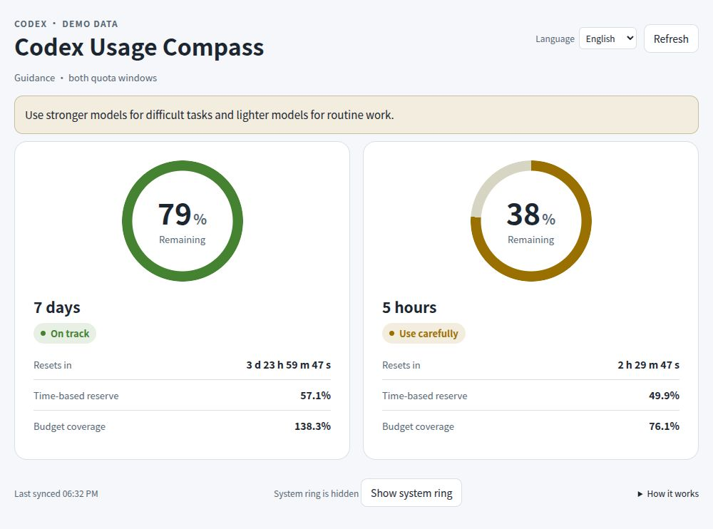
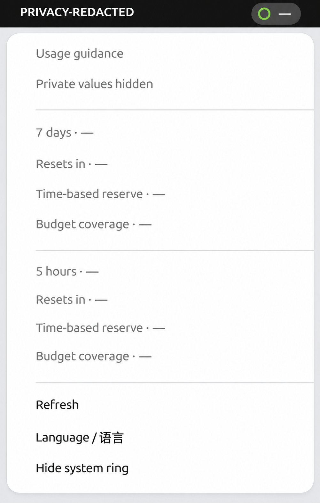

# Codex Usage Compass

[简体中文](README.zh-CN.md)

[Download v0.5.0](https://github.com/NorthHarborLab/codex-usage-compass/releases/tag/v0.5.0)
A local Codex plugin with 7-day and 5-hour budget rings, pacing suggestions, and an automatic Ubuntu panel / Windows 10+ tray / macOS menu bar ring.

## Preview

### Quota dashboard · demo data

The dashboard shows both quota windows, colour-coded rings and pacing guidance. All values in this screenshot are synthetic demo data. The interface is shown in English; Simplified Chinese is also supported.



### Ubuntu system ring · privacy-redacted illustration

Check quota details from the top panel while keeping your current chat open. This illustration was edited from an Ubuntu screenshot with AI assistance: actual usage, reset times and background content have been removed. The dashes and privacy label are editorial redactions, not an in-app privacy mode. Windows uses a notification-area tray icon; its appearance differs.



## Install once, get the system ring

Add this GitHub project as a plugin marketplace in Codex desktop, then install **Codex Usage Compass**:

`https://github.com/NorthHarborLab/codex-usage-compass`

The plugin contains the desktop renderer. Its first local MCP service startup automatically starts the ring, with no companion installation command. On first installation, open the quota panel once if the host has not loaded the service yet. From 0.5.1, Ubuntu automatically registers a per-user login helper that waits for the local Codex/ChatGPT desktop and starts the ring without opening the panel again. Codex does not expose an install-completed callback; startup is tied to the loaded service. Local execution must be allowed by the host. Use signed-in local Codex and its bundled Node runtime, or Node.js 20+ for CLI setups.

- **Ubuntu GNOME:** coloured top-panel ring and remaining quota. Requires GJS, GTK3, AppIndicator/Ayatana and the enabled GNOME AppIndicator extension. When packages are missing, click **Install desktop support** in the panel and approve the OS authorization dialog. This uses Ubuntu apt; a newly installed GNOME extension may require enabling it and logging in again.
- **macOS (Intel and Apple Silicon):** native menu bar ring with remaining quota, hover summary and a click menu for countdowns, refresh, language and hide. Uses the built-in `/usr/bin/osascript` JavaScript bridge and AppKit; no Xcode, Homebrew package or separate companion app is required. Requires a local logged-in graphical session. Node.js comes from the Codex host when provided, otherwise Node.js 20+ must be available (Homebrew Node paths are also detected). The renderer does not automate other apps or request Accessibility / Screen Recording access. No login item or LaunchAgent is installed.
- **Windows 10 / 11:** native notification-area ring, hover summary, and left/right click menu for both windows, countdowns, advice, refresh and language. Check the taskbar's `^` hidden-icon area if necessary. Uses built-in Windows PowerShell 5.1 and .NET Framework; no GJS, Python, or execution-policy changes. Native Windows Codex is required; remote Linux/WSL sessions cannot directly render this tray.

Multiple chats share one ring. Hide it from the menu or panel and restore it from the panel. The choice persists. On Ubuntu, `~/.config/autostart/codex-usage-compass.desktop` starts a small helper at login. It keeps the ring running only while the local desktop app runs, does not launch Codex, and requires no system service or administrator permission. Windows/macOS still follow MCP service lifetime without installing login items. Upgrading stops this project's legacy standalone Linux service to prevent duplicate icons.

Optional Ubuntu local-archive installation:

```sh
sh scripts/install-linux.sh
```

Keep the source directory for local marketplaces. The `all` alias also installs the self-contained plugin. Only the explicit legacy `indicator` mode installs a separate systemd companion.

### Uninstall

Uninstall in Codex plugin management. The ring exits when the service unloads; an existing chat connection may require closing or restarting Codex. On Ubuntu the helper removes its login entry after detecting an uninstall (checked while the desktop runs, within about 30 seconds). To remove the login entry immediately and clean an older standalone installation:

```sh
sh scripts/uninstall-linux.sh all
```

Preferences remain at `~/.config/codex-usage-compass/preferences.json` on Linux, `~/Library/Application Support/codex-usage-compass/preferences.json` on macOS, or `%LOCALAPPDATA%\codex-usage-compass\preferences.json` on Windows. Remove this file to restore automatic display.

## Languages

English and Simplified Chinese are fully translated in the panel and indicator, including errors, guidance, explanations and missing-data states. The panel initially uses the browser language and stores a manual selection when host storage permits. The indicator uses the OS locale and saves its menu selection locally. Other languages fall back to English; Chinese locale variants use Simplified Chinese. Set `USAGE_LANGUAGE=en` or `zh-CN` for server text.

## How guidance works

`reserve = time until reset / window duration × 100%`

`coverage = remaining quota / reserve × 100%`

| Coverage | Colour | Guidance |
|---|---|---|
| <25% | Red | Save for essentials; lighter model / standard speed |
| 25–<50% | Orange | Reduce model size or reasoning effort |
| 50–<80% | Amber | Strong models for difficult work, lighter models for routine work |
| 80–<100% | Blue | Keep a steady pace |
| 100–<150% | Green | Comfortable reserve for more demanding tasks |
| ≥150% | Cyan | Consider a stronger model or Fast mode if available |

The ring is capped at a full circle. Its centre shows actual remaining quota. Suggestions consider both available windows and use the tighter budget. A reserve of 5% or less overrides encouragement to spend more. Expired or stale data suppresses spending suggestions. The dashboard labels missing windows “No data available”. System menus hide the entire 5-hour block while that window is absent, and show it again when data arrives. A known exhausted or expired window stays visible; missing data never implies an unlimited allowance.

This is a steady-pacing heuristic. It does not learn habits or predict model costs. It does not change models or speed settings. A higher speed can consume quota differently depending on the product and plan. Timers update each second; usage refreshes every minute.

## Platform support

Ubuntu GNOME uses GJS/GTK3/AppIndicator; Windows 10+ uses native WinForms NotifyIcon. The Windows smoke and lifecycle tests run on GitHub Actions Windows Server 2022. Windows 10/11 interactive desktop acceptance is still pending. macOS uses AppKit via the built-in JXA bridge, with native smoke, lifecycle and clean Codex loader checks on macOS 15 for Apple Silicon and Intel. Interactive acceptance on a personal Mac, menu bar overflow/notch placement and older macOS versions remain unverified. See VERIFICATION.md for exact coverage.

Each user must sign into their own Codex account. Current accounts may return only a weekly limit. The 5-hour path is tested with fixtures until the account supplies that window.

## Data and security

The plugin invokes the installed `codex app-server` and reads `account/rateLimits/read`. Codex handles authentication and talks to its account service. The plugin does not copy credentials, collect chat contents, run inference, upload quota data to a project server, or persist usage history. Usage stays in process memory; the indicator writes generated ring images to the user's runtime directory. Local language preferences are persisted.

This project is independently developed and is not affiliated with OpenAI. The account protocol and desktop extension interfaces can change.

## Build and verify

```sh
npm ci
npm test
npm run build
CHROME_PATH=/usr/bin/google-chrome node scripts/verify-ui.mjs
```

Prebuilt MCP server and HTML are included, so installing a release does not require npm. See [verification notes](VERIFICATION.md) for the precise clean-install scope and remaining limitations. Bundled dependencies retain their upstream licences in [THIRD_PARTY_LICENSES.txt](THIRD_PARTY_LICENSES.txt).
