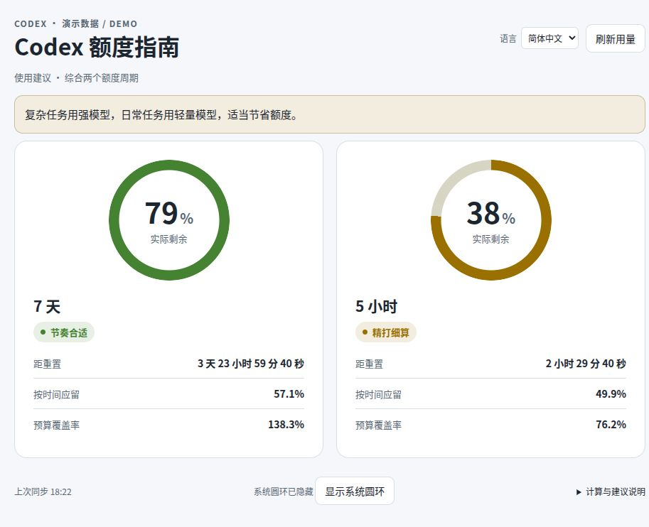
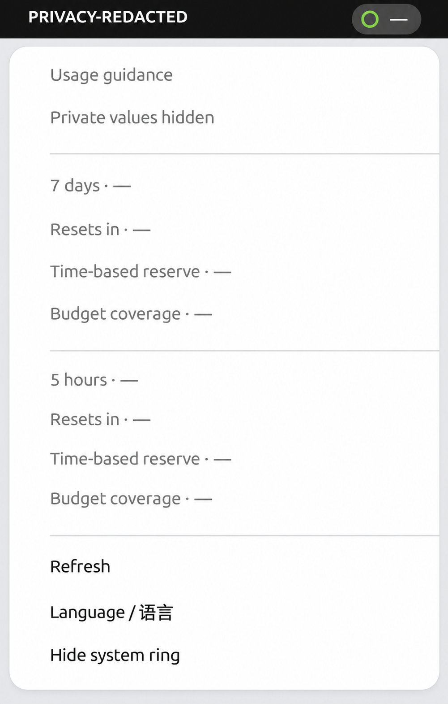

# Codex 额度指南

[English](README.md)

[Download v0.5.0](https://github.com/NorthHarborLab/codex-usage-compass/releases/tag/v0.5.0)
显示 7 天与 5 小时额度圆环，结合剩余时间给出模型和速度建议。Ubuntu 顶栏、Windows 托盘和 macOS 菜单栏圆环可随手展开，查看时保留当前聊天页面。

## 效果预览

### 额度面板 · 演示数据

同时查看两个额度周期、彩色圆环和使用节奏建议。图中所有数值均为模拟演示数据；界面展示简体中文，也支持切换英文。



### Ubuntu 系统圆环 · 脱敏示意

从系统顶栏展开额度详情，保留当前聊天页面。此图由 Ubuntu 截图经 AI 辅助编辑而成，真实用量、重置时间和背景内容均已移除。横线与脱敏标识是图片编辑处理，并非插件内置的隐私模式。Windows 使用通知区域托盘图标，外观有所不同。



## 安装一次，自动带上系统圆环

在 Codex 桌面的插件管理中添加此项目作为插件市场，然后安装 **Codex Usage Compass / Codex 额度指南**：

`https://github.com/NorthHarborLab/codex-usage-compass`

插件包已经包含系统圆环。安装后首次加载本地插件服务时，圆环自动启动，不需要另外运行组件安装命令。首次安装若 Codex 尚未加载服务，打开一次「Codex 额度指南」面板即可完成初始化。Ubuntu 从 0.5.1 起会自动注册当前用户的登录辅助程序：登录后等待本机 Codex/ChatGPT 桌面启动，再加载圆环，无需每次打开面板刷新。这里使用本地 MCP 服务启动入口，安装按钮本身没有可供插件使用的安装完成回调。登录和运行环境由本机 Codex 提供；命令行环境需准备 Node.js 20+ 与已登录的 Codex。

- **Ubuntu GNOME**：顶栏显示彩色圆环与余量，点击查看详情。需要 GJS、GTK3、AppIndicator 和已启用的 GNOME AppIndicator 扩展。缺少软件包时，可在面板点「安装桌面支持」，通过系统授权窗口安装，不需要输入终端命令。扩展初次安装后可能需重新登录桌面并启用。支持自动安装依赖的发行版限使用 apt 的 Ubuntu。
- **macOS（Intel 与 Apple Silicon）**：原生菜单栏圆环及余量，悬停显示摘要，点击查看倒计时、刷新、语言和隐藏操作。使用系统自带 `/usr/bin/osascript` 的 JavaScript 桥接与 AppKit，不需要 Xcode、额外 Homebrew 软件包或单独安装圆环程序。需要本机已登录的图形桌面会话；优先使用 Codex 提供的 Node.js，否则需要可用的 Node.js 20+，也会检测 Homebrew 的常见 Node 路径。圆环不控制其他应用，不申请辅助功能或屏幕录制权限，不创建登录项或 LaunchAgent。
- **Windows 10 / 11**：使用原生通知区域圆环。左键或右键展开双额度、倒计时、建议、刷新和语言菜单；悬停显示摘要。首次运行图标可能被 Windows 收进任务栏的 `^` 隐藏图标区。使用系统自带 Windows PowerShell 5.1 和 .NET Framework，无需另装 GJS 或 Python，也不修改 PowerShell 执行策略。需运行本机 Windows Codex，WSL 和远程 Linux 会话不能直接显示 Windows 托盘。

多个聊天共用一个圆环。面板和系统菜单均可隐藏圆环，偏好会保存；在面板点「显示系统圆环」即可恢复。Ubuntu 的登录辅助程序位于 `~/.config/autostart/codex-usage-compass.desktop`，只在本机桌面应用运行时保留圆环；桌面退出后停止。它不启动 Codex、不创建系统服务，也不申请管理员权限。Windows/macOS 仍随插件服务运行，不创建登录项。关闭面板本身不会停止已加载的插件服务。升级自旧版时，会停用本项目旧的独立 systemd 圆环服务，防止重复图标。

Ubuntu 从本地压缩包安装的备用方式（可选）：

```sh
sh scripts/install-linux.sh
```

保留本地市场来源目录。`all` 参数同样安装自带圆环的插件；旧的独立 Linux 服务仅在明确使用 `indicator` 参数时安装。

## 卸载

在 Codex 插件管理中卸载即可；服务卸载或停止加载后，圆环自动退出。运行中的聊天若仍保留旧插件连接，可关闭该连接或重新打开 Codex。Ubuntu 辅助程序检测到卸载后会停止并移除登录入口（桌面运行期间检查，最长约 30 秒）。也可用以下脚本立即移除登录入口并清理旧版独立服务：

```sh
sh scripts/uninstall-linux.sh all
```

偏好保留在 Linux 的 `~/.config/codex-usage-compass/preferences.json`、macOS 的 `~/Library/Application Support/codex-usage-compass/preferences.json` 或 Windows 的 `%LOCALAPPDATA%\codex-usage-compass\preferences.json`。删除偏好文件可恢复默认自动显示。

## 颜色和建议

覆盖率为「实际余量 ÷ 按时间应留额度」。应留额度为「距重置分钟数 ÷ 周期分钟数 × 100%」。周周期为 10,080 分钟，5 小时周期为 300 分钟。

| 覆盖率 | 颜色 | 使用建议 |
|---|---|---|
| 低于 25% | 红 | 留给重要任务，轻量模型、标准速度或等待重置 |
| 25% 至不足 50% | 橙 | 降低模型或推理强度 |
| 50% 至不足 80% | 黄 | 复杂任务用强模型，日常任务节省额度 |
| 80% 至不足 100% | 蓝 | 保持平稳节奏 |
| 100% 至不足 150% | 绿 | 余量宽裕，重要任务可用更强模型 |
| 150% 起 | 青 | 可以尝试更强模型或套餐支持的快速模式 |

圆环最多填满一圈，中心显示实际余量。建议同时参考两个可用窗口，实际余量 ≤5% 时优先提醒节省。周期到期或数据超过两分钟时先等待更新。面板中缺失窗口显示「暂无数据」。系统菜单在没有 5 小时数据时隐藏整个区块，读到数据后自动恢复；已知额度耗尽或等待重置的窗口仍保留显示。

这些建议依据均匀使用节奏计算，目前没有历史习惯学习功能。模型和速度选项依套餐而定，建议不会自动更改设置。倒计时每秒更新，用量每分钟同步。

## 多语言与支持范围

面板及顶栏完整支持简体中文和英文，可手动切换。其他语言回退英文，其他中文地区设置使用简体中文。面板跟随浏览器语言，顶栏跟随系统语言，手动选择会在存储可用时保留。

Ubuntu GNOME 已进行隔离插件安装和实际系统托盘协议测试。Windows 实现面向 Windows 10 及以上，原生冒烟测试和生命周期测试的结果见 VERIFICATION.md；尚无 Windows 10/11 人工桌面验收。macOS 使用系统自带 JXA 桥接调用 AppKit；CI 在 macOS 15 的 Apple Silicon 与 Intel 环境检查原生菜单、生命周期和 Codex 干净安装加载。个人 Mac 的人工桌面验收、刘海屏菜单栏空间及更早 macOS 版本仍待验证。5 小时窗口使用模拟数据测试，当前实际账户只返回周额度。

## 数据与开发

插件调用本机 `codex app-server` 的 `account/rateLimits/read`。认证由 Codex 处理，每位使用者登录自己的账户。插件不会复制凭据、读取聊天内容、运行推理或上传用量到项目服务器。用量仅保存在内存，语言偏好和运行时圆环图片保存在本机。

这是独立项目，与 OpenAI 无隶属关系。额度接口和桌面扩展接口可能随版本变化。

```sh
npm ci
npm test
npm run build
CHROME_PATH=/usr/bin/google-chrome node scripts/verify-ui.mjs
```

发布包包含预构建文件，安装无需 npm。详细测试范围见 [VERIFICATION.md](VERIFICATION.md)，依赖许可证见 [THIRD_PARTY_LICENSES.txt](THIRD_PARTY_LICENSES.txt)。
